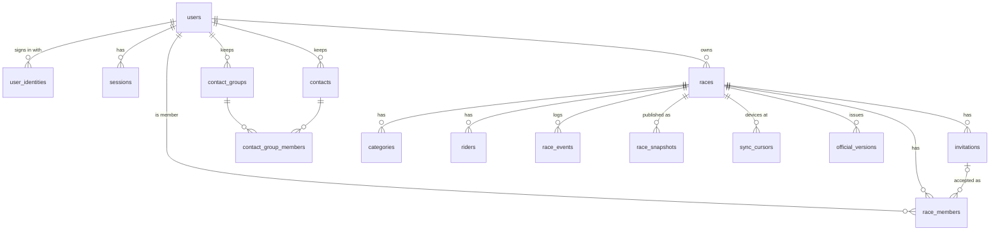

# Commissaire server database

PostgreSQL design for the multi-user server. It mirrors what the app already
keeps in IndexedDB (`commissireDb` v9) and adds only what accounts, membership,
invitations, sync and official results need. Business rules stay in TypeScript
(`src/shared/race`); the database has no triggers or stored functions.

Migrations: `server/sql/001-…005-*.sql`, applied in order by the API's runner
(each records itself in `schema_migrations`). `000-create-database.sql` is run
once by hand. `verify.sql` checks the result.

## Conventions

- **Same field names as the app.** Columns use the client's camelCase names
  (quoted in SQL: `"bibNumber"`), so a row is the JSON the app already reads.
  A few RaceProps/RiderProps names that are already snake_case or misspelled
  (`position_category`, `orgenizer`) are kept as they are.
- **Server key = `uuid`.** Races already have a `uuid`; riders and categories get
  one when the race is published. The numeric `id` stays on the device.
- **Every race record carries `"raceUuid"`** (the name RiderProps and
  CategoryProps already use), `NOT NULL` and referencing `races`. Every query
  filters by it; deleting a race removes only its rows (tested).
- One PostgreSQL database for all races; isolation is by `"raceUuid"`.

## IndexedDB → PostgreSQL

| IndexedDB store (type) | PostgreSQL | Notes |
|---|---|---|
| `races` (RaceProps) | `races` | Same fields. Key `uuid`. Adds `"ownerUserId"`, `"joinCode"`, `"lastSeq"`. Not stored (device-only): `id`, `isFavorite`, `viewOnly`, `syncedAt`, `serverVersion`, `isPrivate`/`password`. `finalized` comes from `official_versions`. |
| `categories` (CategoryProps) | `categories` | Same fields. Key `uuid`. Not stored (derived): `lapsCounter`, `riders` (count). |
| `riders` (RiderProps) | `riders` | Same fields. Key `uuid`. Lap and position fields are the current state computed by the rules engine. Not stored: `id` (device-local), `extraFields` ("Keep as info", AD-12). |
| `race_events` (RaceEvent, old cloud log) | `race_events` | Same purpose and name; rows are now the Action envelope (`"actionId"`, `type`, `payload`, `"deviceTime"`, `"clockOffsetMs"`, `"deviceId"`, `"userId"`, `seq`, `applied`, `reason`). The device-side `syncStatus` becomes the outbox state on the device. |
| `users`, `roles` (local RBAC) | — | Device-only token and preset lists; not migrated. Server accounts are `users` + `user_identities`; roles live on `race_members`. |
| Laps (`rider.lapsDetails`) | `riders."lapsDetails"` + `race_events` | The app has no laps store. Each lap is an `AddLap` row in `race_events`; `lapsDetails` keeps the computed list in the same JSON shape. |
| RaceProps.`finalized` | `official_versions` | One row per official version (1 = finalize, 2+ = amendments). The API returns the latest as the same RaceFinalization JSON. |
| Device-only (stay in IndexedDB/localStorage) | — | Favorites, view-only downloads, Jokers, action-log view, board hold, voice/theme/Results preferences, club dictionary, import templates, demo race. |

## ERD

## Tables with no IndexedDB equivalent

| Table | Why it is needed |
|---|---|
| `schema_migrations` | Which migration files have run. |
| `users` | One row per person; everything points at `users.id`, never at an email. |
| `user_identities` | Sign-in methods per user (password, Google, email OTP, SMS later). Several per user = account linking. Passwords only as a hash. |
| `sessions` | Refresh-token sessions for sign-out and revoke (hash only). |
| `otp_codes` | Email OTP now, SMS OTP later (hash only, short expiry, purged after 24 h). |
| `race_members` | Who may do what in which race: a set of roles plus an optional category scope. One user can be in many races with different roles. |
| `invitations` | Email, existing-user, link and QR invitations. Access exists only after the invitee signs in and accepts (then a `race_members` row is created). Only a hash of the link secret is stored. |
| `contact_groups`, `contacts`, `contact_group_members` | An organizer's reusable directory ("Federation A"). Grants no race access by itself. |
| `race_snapshots` | The race as published (`seq` 0); replaying `race_events` on it must give the stored state. |
| `sync_cursors` | Last `seq` and queue depth per device, for catch-up and the owner's team sync view. |
| `official_versions` | Signed official results and amendments, kept as a chain. |

## Access: roles, screen permissions, data scope

Per race and per member, three independent parts (rules in `src/shared/race/access.ts`):

| Part | Stored in | Meaning |
|---|---|---|
| Roles | `race_members.roles` | Any set of `admin`, `start`, `counter`, `checkin`, `viewer` (FR-10). The owner is `races."ownerUserId"` and always has full access; nothing can override it. Roles give default screen permissions. |
| Screen permissions | `race_members.permissions.screens` | Per screen (`info`, `map`, `schedule`, `categories`, `riders`, `results`, `start`, `checkin`, `board`, `status`, `live`, `team`, `settings`): `view`, `create`, `update`, `delete`. Overrides of the role defaults set by the owner or an admin. No write without view. |
| Data scope | `race_members.permissions.waves` / `.categories` | Waves (heat numbers) and, for counters, categories the member may see and act on. Unset = all. |

Examples: a spectator is `roles: []`, `permissions: {"screens": {"live": {"view": true}, "results": {"view": true}}, "waves": [3]}`; a wave-1 lap commissaire is `roles: ["counter"]`, `permissions: {"waves": [1]}`.

The API checks the exact operation each Action needs (e.g. Undo needs `live.delete`) and
filters everything it sends (responses, snapshots, catch-up, socket events) with the
same rules: hidden waves, out-of-scope riders, lap data without a results-type screen,
and private rider details without Riders or Check-In are never sent.
`race_events.heat` (wave of each action) and `"changedSeq"` on races, categories and
riders let catch-up return only rows a member may see.

## Timing

`race_events` stores both clocks: `"deviceTime"` + `"clockOffsetMs"` (the
device's offset to the server clock, measured before the tap) and
`"receivedAt"` (server clock on arrival). Lap times use
`deviceTime + clockOffsetMs`, which is server-clock time at the moment of the tap.
`receivedAt` alone would time an offline lap, or a lap sent after a bunch
of taps, at the moment it reached the server.

## Unavoidable differences

1. Riders and categories get a server `uuid`; the device keeps its numeric `id` and maps it.
2. `"raceUuid"` everywhere (as in RiderProps), so the Action envelope's `raceId`
   and payload `riderId`/`categoryId` (Story 2.1 draft) become `raceUuid`,
   `riderUuid`, `categoryUuid`. `RaceProps.raceId` keeps its existing meaning
   (readable "YYYY-MM-DD-name").
3. Derived category counters and the rider's "Keep as info" `extraFields` are not stored.
4. Duplicate bibs are not blocked by the database (the app allows them during setup with a warning); the rules engine rejects them where Story 2.6 says so.
5. Append-only `race_events` is enforced by the API code (no UPDATE/DELETE statements) and checked by tests; no trigger.

## Setup (you run this; nothing here touches El Niño)

1. On the server, as a PostgreSQL superuser:
   `sudo -u postgres psql -v app_password='<new secret>' -f server/sql/000-create-database.sql`
   (creates role and database `commissaire_live`; the existing `commissaire`
   database and `commissaire_app` role are not touched).
2. Add one `pg_hba.conf` line for `commissaire_live` from the API host only, then `SELECT pg_reload_conf();`.
3. Apply the migrations as `commissaire_live`, in order:
   `for f in 001 002 003 004 005; do psql "$COMMISSAIRE_DATABASE_URL" -v ON_ERROR_STOP=1 -1 -f server/sql/$f-*.sql; done`
4. Check: `psql "$COMMISSAIRE_DATABASE_URL" -f server/sql/verify.sql` — each query states its expected result.

The API reads one variable, `COMMISSAIRE_DATABASE_URL`
(`postgresql://commissaire_live:<secret>@<host>:5432/commissaire_live?sslmode=require`), never El Niño's `DATABASE_URL`.
